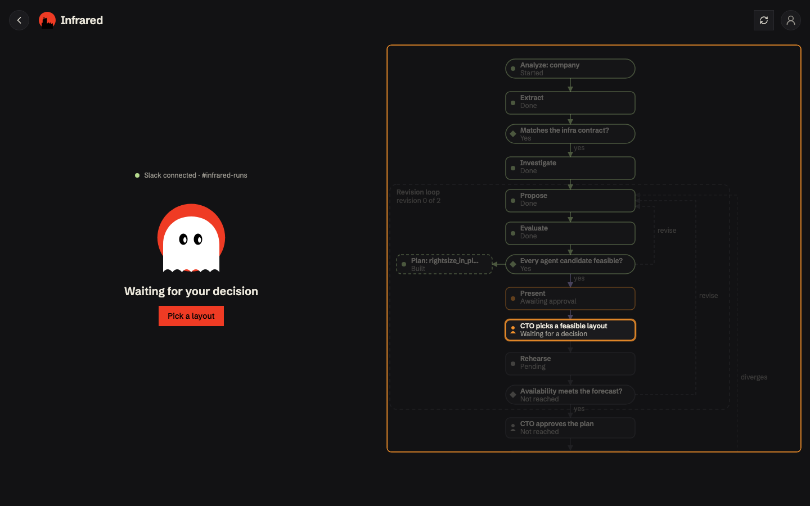
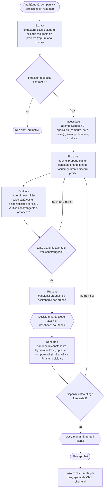

# Infrared

Un workflow agentic care replanifică infrastructura cloud a unei companii în jurul proiectelor din roadmap-ul ei financiar: găsește ce se poate optimiza, propune planuri, le verifică cu un motor determinist, le repetă într-un sandbox și îi lasă pe oameni să decidă, din dashboard sau din Slack.

Repo: https://github.com/vlaxcs/uipath-infrared · Descriere: [docs/descriere.md](docs/descriere.md) · Specificație: [docs/spec.md](docs/spec.md)



## Pornire

```bash
make demo
```

Pornește Floci (emulatorul AWS), orchestratorul (:8080), dashboard-ul (http://127.0.0.1:5173/app/) și botul de Slack; Ctrl-C le oprește. Prima dată: completează `.env` (creat din `.env.example`) cu `ANTHROPIC_API_KEY` și tokenurile `SLACK_*`, apoi `make estate` construiește compania demo în Floci. `make help` arată restul.

## Workflow-ul agentic



Regula de bază: **LLM-ul propune, motorul decide, LLM-ul explică.** Fiecare cifră vine din motor, nu din model.
